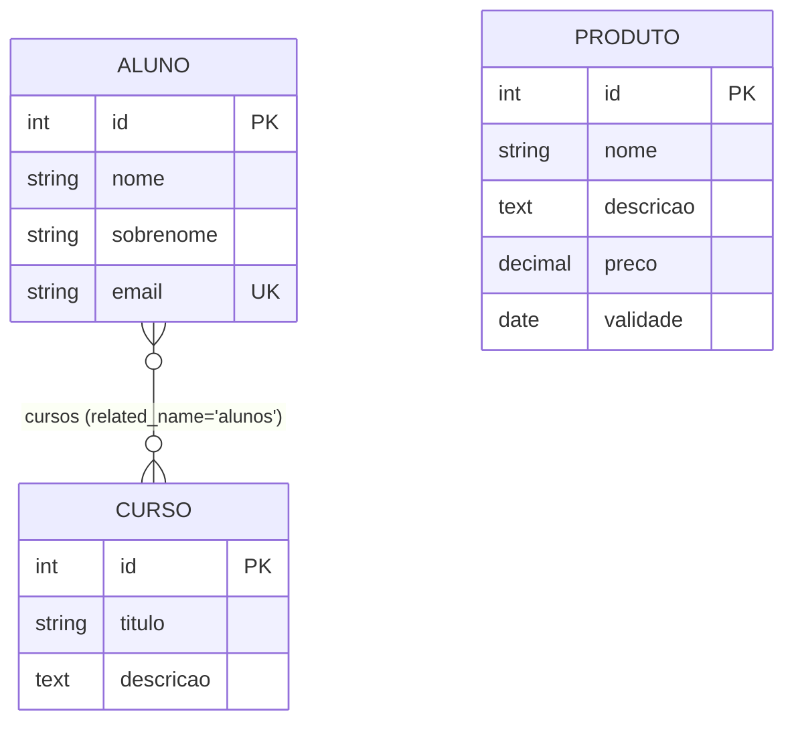

# Sistema de Cadastro de Alunos, Cursos e Produtos (EA 1 e EA 2)

Projeto Django desenvolvido para as atividades **EA 1** e **EA 2** (Arquitetura de Sistemas), implementando:
- **EA 1:** Cadastro de **alunos** e **cursos** com relacionamento **muitos-para-muitos (N:N)** via Django Admin e listagem pública.
- **EA 2:** Cadastro de **produtos** com **ModelForm (`ProdutoForm`)** e view `produto_new` funcionando de forma independente, **sem precisar do Django Admin**.

---

## Mapa do Projeto

```text
E.A1/
├── manage.py                         # Utilitário de linha de comando do Django
├── requirements.txt                  # Lista de dependências Python (Django 6.1.3)
├── .gitignore                        # Arquivos ignorados pelo Git (venv, db.sqlite3, __pycache__)
├── README.md                         # Documentação e guia de execução do projeto
│
├── escola/                           # Pacote principal de configuração do projeto
│   ├── __init__.py
│   ├── asgi.py                       # Ponto de entrada ASGI
│   ├── wsgi.py                       # Ponto de entrada WSGI
│   ├── settings.py                   # Configurações (INSTALLED_APPS, pt-br, America/Maceio, SQLite)
│   └── urls.py                       # Roteamento raiz (/admin/ e inclusão de cadastro.urls)
│
└── cadastro/                         # App responsável pelos cadastros
    ├── __init__.py
    ├── admin.py                      # Registro e configuração de AlunoAdmin e CursoAdmin
    ├── apps.py                       # Configuração do app (CadastroConfig)
    ├── forms.py                      # ProdutoForm (ModelForm para o modelo Produto)
    ├── models.py                     # Models Curso, Aluno (ManyToMany) e Produto
    ├── views.py                      # Views listar_alunos, listar_cursos, listar_produtos e produto_new
    ├── urls.py                       # Rotas /alunos/, /cursos/, /produtos/ e /produtos/novo/
    ├── tests.py                      # Arquivo de testes do app
    ├── migrations/
    │   ├── __init__.py
    │   ├── 0001_initial.py           # Migração inicial (Curso e Aluno)
    │   └── 0002_produto.py           # Migração da EA 2 (Produto)
    └── templates/
        ├── base.html                 # Template base com bloco  e barra de navegação
        └── cadastro/
            ├── alunos.html           # Listagem de alunos e seus respectivos cursos
            ├── cursos.html           # Listagem de cursos e seus respectivos alunos
            ├── produtos.html         # Listagem de produtos cadastrados
            └── produto_form.html     # Formulário de cadastro de produto (com )
```

---

## Arquitetura e Fluxo de Requisição

O projeto segue o padrão **MVT (Model-View-Template)** do Django:

```text
Navegador (/alunos/, /cursos/, /produtos/ ou /produtos/novo/)
   │
   ▼
escola/urls.py ──► cadastro/urls.py
                      │
                      ▼
               cadastro/views.py (listar_alunos / listar_cursos / listar_produtos / produto_new)
                      │  (GET exibe formulário ou lista; POST valida ProdutoForm e salva)
                      ▼
               cadastro/models.py (Aluno / Curso / Produto no SQLite)
                      │
                      ▼
               cadastro/templates/cadastro/*.html (herdam de templates/base.html)
```

---

## Modelagem de Dados (`cadastro/models.py`)



- **`Curso`**: `titulo` (`CharField`, máx. 150 caracteres) e `descricao` (`TextField`).
- **`Aluno`**: `nome` (`CharField`, máx. 100), `sobrenome` (`CharField`, máx. 100), `email` (`EmailField`, único) e `cursos` (`ManyToManyField(Curso, related_name='alunos', blank=True)`).
- **`Produto` (EA 2)**: `nome` (`CharField`, máx. 150), `descricao` (`TextField`), `preco` (`DecimalField(10, 2)`) e `validade` (`DateField`).

---

## Rotas Disponíveis

| Rota | View / Destino | Nome da URL | Descrição |
| :--- | :--- | :--- | :--- |
| `/alunos/` | `cadastro.views.listar_alunos` | `listar_alunos` | Lista todos os alunos e os cursos matriculados (`aluno.cursos.all`). |
| `/cursos/` | `cadastro.views.listar_cursos` | `listar_cursos` | Lista todos os cursos e os alunos matriculados (`curso.alunos.all`). |
| `/produtos/` | `cadastro.views.listar_produtos` | `listar_produtos` | Lista todos os produtos cadastrados. |
| `/produtos/novo/` | `cadastro.views.produto_new` | `produto_new` | Exibe e processa o `ProdutoForm` (cadastro sem Django Admin). |
| `/admin/` | `admin.site.urls` | — | Painel administrativo com `AlunoAdmin` e `CursoAdmin`. |

---

## Configurações Principais (`escola/settings.py`)

- **App registrado:** `'cadastro'` em `INSTALLED_APPS`
- **Idioma:** `LANGUAGE_CODE = 'pt-br'`
- **Fuso horário:** `TIME_ZONE = 'America/Maceio'`
- **Banco de dados:** SQLite (`db.sqlite3`)

---

## Como Executar Localmente

### 1. Clonar o repositório e entrar na pasta

```bash
git clone https://github.com/gabrieltrabalhos478-art/E.A1-Arquitetura-de-Sistemas.git
cd E.A1-Arquitetura-de-Sistemas
```

### 2. Criar e ativar o ambiente virtual (`venv`)

**Windows (PowerShell):**
```powershell
python -m venv venv
.\venv\Scripts\Activate.ps1
```

**Linux / macOS:**
```bash
python3 -m venv venv
source venv/bin/activate
```

### 3. Instalar as dependências

```bash
pip install -r requirements.txt
```

### 4. Aplicar as migrações e validar o projeto

```bash
python manage.py check
python manage.py migrate
```

### 5. (Opcional) Criar superusuário para cadastrar Alunos/Cursos no Admin

```bash
python manage.py createsuperuser
```

### 6. Iniciar o servidor de desenvolvimento

```bash
python manage.py runserver
```

Acesse no navegador:
- Alunos: `http://127.0.0.1:8000/alunos/`
- Cursos: `http://127.0.0.1:8000/cursos/`
- Produtos: `http://127.0.0.1:8000/produtos/`
- Cadastrar Produto (sem Admin): `http://127.0.0.1:8000/produtos/novo/`
- Admin: `http://127.0.0.1:8000/admin/`
